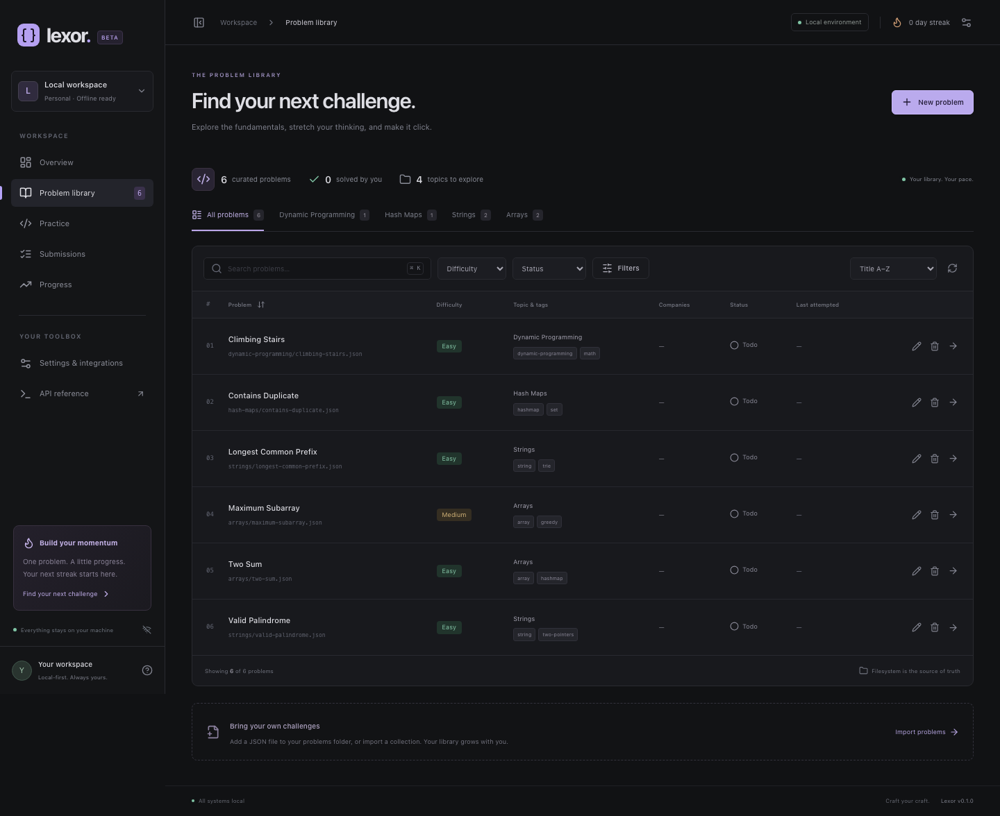
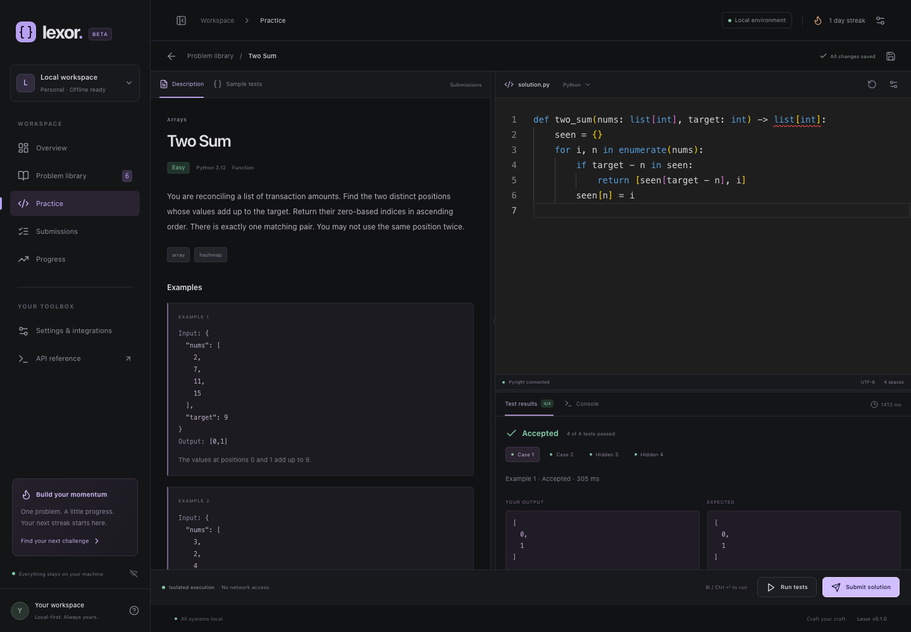
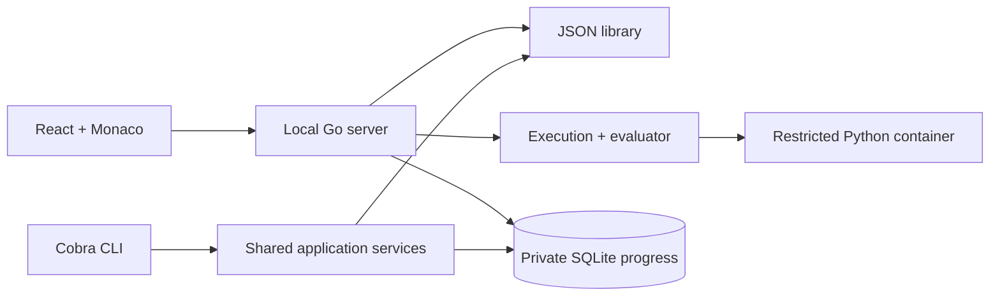

# Lexor

**A quiet place to think, solve, and grow.**

Lexor is a local-first coding practice workbench. Start one Go executable, open your browser, and practice against a portable library of JSON problems. Problems, drafts, accepted solutions, history and progress stay on your machine.



## What works

- A searchable problem library with topic, tag, company, difficulty and solved/attempted/todo filters, folder metadata, sorting and explicit rescan.
- Structured and raw JSON problem editing, examples, public/hidden test editors, schema feedback, atomic saves and stale-edit protection.
- Monaco Python editing, resizable panels, optional real Pyright completion/type diagnostics/hover/signature help, editor themes and shortcuts.
- Public runs and all-test submissions in isolated, resource-limited containers. Accepted/Wrong Answer, runtime/syntax errors, timeout, memory and output-limit diagnostics.
- Durable SQLite drafts, submission/run history, accepted progress, streaks, activity heatmap and difficulty breakdown. Restore historical source as a draft.
- Local-file/directory, HTTPS JSON and public HTTPS Git imports with validation previews and collision protection.
- Explicit allowlisted progress export, optional Git commit/push using existing credentials. No credentials or SQLite database are exported.
- Compile-time language/sandbox/evaluator/source extension boundaries, a sample plugin, generated OpenAPI/TypeScript models and automated tests.

Six original starter exercises cover arrays, strings, hash maps and dynamic programming. No proprietary problem descriptions are copied.

## Quick start

Build from a checkout of this repository:

```sh
cd lexor
make setup
make build
./bin/lexor serve
```

Open **http://127.0.0.1:8080**. The server initializes missing workspace directories and SQLite automatically. `lexor init` explicitly initializes a workspace and adds the original starter library without overwriting existing problems.

Prerequisites for source builds:

- Go 1.26+; `go.mod` pins the tested Go 1.26.9 toolchain.
- Bun 1.4.2 and a current Node.js runtime (Node 22.12+ or 24 recommended). Node powers optional Pyright and frontend build tools.
- Git for Git import/export operations.
- Docker Desktop on macOS or Docker Engine on Linux **for executing solutions**.

Download the pinned runtime image once:

```sh
docker pull python:3.12.15-alpine3.23
./bin/lexor doctor
```

After dependencies and the image are cached, the application works without an internet connection. The production binary serves all SPA/Monaco assets itself; Bun/Node are not needed to serve it. Node/Pyright are only needed at runtime if semantic editing is enabled. Execution never silently falls back to a host Python interpreter.

To put the built executable on your PATH, copy `bin/lexor` to a directory you control, such as `~/.local/bin`. There is no published release/install URL yet. A bare `go install` from an unbuilt source checkout cannot manufacture frontend assets; use `make build`.

## Everyday commands

```sh
lexor init
lexor serve --port 8080
lexor --workspace ~/practice serve
lexor doctor
lexor problem list
lexor problem validate
lexor problem export arrays.two-sum > two-sum.json
lexor stats
lexor plugin list
```

Keep one server process per workspace. The default bind address is loopback; this release does not provide authentication for a shared/public deployment.

## Practice

Open the problem library, choose **Two Sum**, and edit the Python function. **Run tests** checks visible examples; **Submit solution** checks every local test and records a submission. Hidden expected/actual values, errors and console are redacted from execution results, but the JSON files remain visible to the workspace owner.

- Cmd/Ctrl + Enter: run samples.
- Cmd/Ctrl + Shift + Enter: submit.
- Cmd/Ctrl + K on the library: focus search.
- Drafts autosave to SQLite, with a browser backup while a save is pending.
- Editor preferences are available above Monaco; application appearance is in Settings.



In a source checkout, `make setup` installs pinned Pyright locally and Lexor detects it. For a standalone binary, install it explicitly:

```sh
npm install -g pyright
lexor doctor
```

You can also set `LEXOR_PYRIGHT_COMMAND` to a trusted `pyright-langserver` executable. Without it the editor still works and displays an actionable unavailable state.

## Create and organize problems

Choose **New problem** in the library, or add a JSON file and click **Rescan library**. Every problem uses `schemas/problem/v1.schema.json`; titles/descriptions, organization, constraints, examples, languages, tests and provenance are required. A minimal complete example and comparison rules are in [the schema guide](docs/problem-schema.md).

```json
{
  "schemaVersion": "1.0.0",
  "id": "arrays.two-sum",
  "slug": "two-sum",
  "title": "Two Sum",
  "difficulty": "easy",
  "comparison": {"mode":"exact"}
}
```

This is an identifying excerpt, not a complete importable problem. See `problems/arrays/two-sum.json` for the full runnable document. Filesystem folders and the logical topic path are separate. No progress fields are written into problem files.

## Import a library

Preview first, then explicitly install:

```sh
lexor problem import ./collection
lexor problem import ./collection --apply
lexor problem import ./problem.json --apply
lexor problem import https://example.org/problems.json
lexor problem import --git https://github.com/owner/problem-pack.git
lexor problem import --git ./private-local-clone --apply
```

The remote URLs above illustrate the accepted reference format; replace them with a real collection. Settings provides the same preview/confirm workflow. Sources must match the schema; imports do not run scripts or overwrite IDs. Public remote Git uses HTTPS only. Clone private repositories yourself with Git, then import the local clone. Use `lexor-pack.json` to select problem paths in a larger repository. Source provenance/digest is retained locally.

## Git progress backup

The default export directory is `.lexor/sync`, configurable in `lexor.yaml`:

```sh
lexor sync init
lexor sync --preview
lexor sync
lexor sync --commit
# Connect your private repository using your own URL/credentials:
git -C .lexor/sync remote add origin <your-private-repository-url>
# Configure your upstream with Git, then use:
lexor sync --commit --push
```

The angle-bracket URL is a placeholder. The exporter includes only `manifest.json`, latest accepted Python solutions, progress and activity. It excludes drafts, config, tokens, database and temporary files. No automatic commits occur unless `git.auto_commit` is enabled; push always requires an explicit flag. Unrelated staged files are excluded from commits. This release does not merge remote progress back into the workspace or force-push.

## Configuration

Precedence: **explicit CLI flags → `LEXOR_*` environment → `lexor.yaml` → defaults**. Relative paths resolve against `--workspace` (default current directory). Server flags are `--host` and `--port`; the workspace flag applies to all commands.

Generated `lexor.yaml` contains:

```yaml
server: {host: 127.0.0.1, port: 8080}
problems: {directory: ./problems}
database: {path: ./.lexor/lexor.db}
execution:
  default_language: python
  timeout_seconds: 5
  memory_mb: 256
  max_output_kb: 256
sandbox:
  provider: container
  runtime: docker
  image: python:3.12.15-alpine3.23
intelligence:
  enabled: true
  command: pyright-langserver
git:
  enabled: false
  directory: ./.lexor/sync
  auto_commit: false
```

Environment keys: `LEXOR_HOST`, `LEXOR_PORT`, `LEXOR_PROBLEMS_DIRECTORY`, `LEXOR_DATABASE_PATH`, `LEXOR_TIMEOUT_SECONDS`, `LEXOR_MEMORY_MB`, `LEXOR_MAX_OUTPUT_KB`, `LEXOR_SANDBOX_RUNTIME`, `LEXOR_SANDBOX_IMAGE`, `LEXOR_PYRIGHT_COMMAND`, `LEXOR_INTELLIGENCE_ENABLED`, `LEXOR_SYNC_DIRECTORY`. Git export is always an explicit command; `git.enabled` does not start background synchronization.

Limits: 1–60 seconds per execution job, 32–4096 MB memory and 1–1024 KB output. The initial IANA activity timezone is stored in SQLite so DST works and travel does not rewrite history. First accepted submissions count as new solves; repeat accepts count as activity; test runs do not create streak days.

## Development and tests

```sh
make setup
make dev                  # backend :8080 + Vite; open the Vite URL
make build                # generate contracts, build frontend, embed in bin/lexor
make test                 # ordinary Go tests + Vitest/Testing Library
make lint                 # formatting check, go vet, TypeScript, ESLint
make fmt
make test-integration     # actual Docker + actual installed Pyright
cd web && bunx playwright install chromium && cd ..
make test-e2e             # temporary workspace, browser, restart persistence
make clean                # build artifacts only; retains workspace data
```

For a direct frontend workflow: `cd web && bun install && bun run dev`. The development proxy expects the backend at `127.0.0.1:8080`. Build frontend assets before running a production `go build ./cmd/lexor`. `make generate` rebuilds OpenAPI and TypeScript types; do not edit `web/src/types/api.generated.ts` manually.

CI config checks formatting, Go race/unit tests, frontend lint/tests, schemas, generated contracts, production/cross-platform builds, real sandbox/LSP integration, Playwright and dependency vulnerabilities. Local evidence and platform limits are in [verification](docs/verification.md); a configured CI job is not a claim that a hosted run has occurred.

## Troubleshooting

| Symptom | Action |
| --- | --- |
| Sandbox unavailable | Start Docker; pull the exact configured image; run `lexor doctor`. |
| Time Limit Exceeded on a slow cold start | Increase `execution.timeout_seconds` or `LEXOR_TIMEOUT_SECONDS`. The budget covers the whole job including containers. |
| Pyright unavailable | Install Node/Pyright or set `LEXOR_PYRIGHT_COMMAND`; editing still works. Only one LSP session runs at a time. |
| Problem missing | Run `lexor problem validate`; fix malformed files/duplicate IDs and rescan. |
| Save returns 409 | Reload the problem: another editor changed its revision. |
| HTTPS/Git import blocked | Use public HTTPS on port 443; private/reserved network sources are deliberately denied. Import a local clone/file instead. |
| Git commit/push fails | Configure Git user identity, remote and upstream; inspect ordinary Git diagnostics. No force-push fallback exists. |
| Unbuilt frontend page | Run `make build` and restart the resulting binary. |

## Contributing and design

See [architecture](docs/architecture.md), [sandbox security](docs/sandbox-security.md), [plugin development](docs/plugin-development.md), [ADRs](docs/adr), [OpenAPI](docs/openapi.json), and [future work](docs/roadmap.md). Run `go run ./examples/plugins` for the compile-time extension sample.



MIT licensed. The bundled exercise descriptions are original Lexor content.
