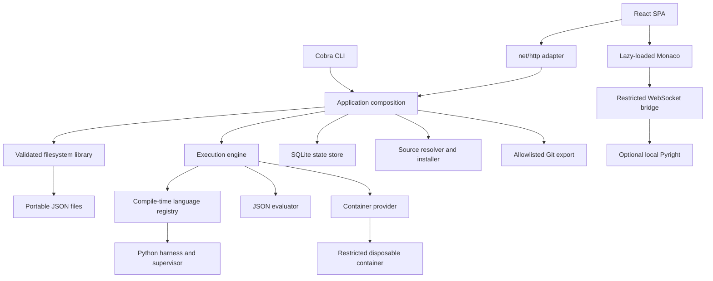

# Architecture

Lexor is a single-user modular monolith. The same application object wires services for the CLI and HTTP adapter. There are no hosted databases, accounts, analytics, background queues, or polling loops.

## Package boundaries

- `cmd/lexor` is the executable entry point; `internal/cli` adapts Cobra commands.
- `internal/config` loads workspace YAML and environment overrides. `internal/app` initializes storage, schema/library, plugins, sandbox, and engine.
- `internal/problems` owns discovery, schema/semantic validation, CRUD and the in-memory snapshot. Compact packages keep these closely related operations together without one-file-per-layer indirection.
- `pkg/pluginapi` contains typed domain messages and compile-time extension interfaces. Implementation packages stay internal. Contract version 1 is independent of problem schema v1.
- `internal/execution` depends on problem lookup, language registry, sandbox and recorder interfaces; it contains no language-specific execution branches. Python-specific protocol logic lives in `internal/languages/python`.
- `internal/persistence` owns SQLite migrations and queries. It is a state store, not a second authoritative problem library.
- `internal/registry`, `internal/syncgit` and `internal/intelligence` are bounded adapters for sources, progress export, and optional semantic editing.
- `internal/server` owns routes, consistent JSON errors, host/origin/CSRF checks, embedded assets and OpenAPI generation.
- `web/src/features` owns routed views. Reusable editor, description, forms and results components live under `components`; the draft lifecycle is in `hooks/useDraft.ts`.

## A practice request

The browser obtains a per-process CSRF token, loads the problem and draft concurrently, then lazily initializes Monaco. A browser backup covers the interval before an autosave reaches SQLite; serialized saves avoid older in-flight requests replacing newer drafts.

Run/Submit sends a typed problem/language/source request. The engine resolves the indexed, previously validated problem and language, checks sandbox prerequisites and admits one job at a time. Run selects public cases; Submit also selects hidden cases. Each case gets a fresh container, interpreter, source and JSON input. A trusted container bootstrap writes the runner artifact into a bounded tmpfs; there are no bind mounts. The Python child writes a dedicated JSON result file while its supervisor drains stdout/stderr separately with output caps.

The host parses the result, evaluates values, redacts hidden values/errors/console, and atomically records the execution plus progress/activity changes in SQLite. The response refreshes dashboard/history queries. Any sandbox prerequisite failure produces an actionable `Sandbox Unavailable` result; there is no host-interpreter fallback.

The timeout and output budget span the whole case sequence. Reported duration includes container startup/teardown; memory is the maximum Python-child peak RSS reported by the harness, not container-wide peak memory. Container memory enforcement is independent of this informational metric.

## Problem and state persistence

JSON files are discovered recursively, capped at 2 MB, schema validated and semantically checked. Symlinks are skipped and reported. Logical `organization.path` and actual `file` are separate concepts. Creates derive safe file paths from IDs; existing files keep their discovered path. Mutations use root-confined `os.Root` operations, exclusive temporary files, fsync and atomic rename. Revision SHA-256 values are compared against the current disk bytes on update/delete. Rescan refreshes changes made by external editors; no filesystem watcher runs.

SQLite enables WAL, foreign keys, a busy timeout, and one connection. Embedded versioned SQL migrations are recorded transactionally. Executions store structured results and source; drafts have independent rows. Progress, daily activity, appearance settings and source installation provenance remain local. Deleting a problem preserves historical user state.

Only submissions affect problem progress. The first accepted submission creates one new solve; repeats qualify for activity but never inflate new solves. Test runs and sandbox-unavailable results do not create a solved day. Current streak permits an active streak ending yesterday; longest streak scans distinct qualifying dates. Calendar arithmetic handles DST. The workspace's initial IANA timezone is persisted; travel does not silently reassign old dates. Systems without a detectable IANA zone use an explicit fixed-offset fallback.

## Frontend, contracts and build

TanStack Query caches server state without background polling. React Router provides desktop-oriented routes. Monaco, Python syntax support, workers, icons, fonts and styles are local bundle assets; no CDN is needed. Tailwind is available, with semantic CSS tokens for the dark/light workbench. Screenshots come from real browser tests.

`internal/server.OpenAPI` derives model schemas from handler Go types. `make generate` writes `docs/openapi.json` and runs `openapi-typescript` to generate frontend models. UI code aliases these models rather than maintaining duplicate REST DTOs. The JSON problem schema remains the stricter authoring validation contract. CI checks generated artifacts for drift.

`bun run build` emits hashed assets inside the `web` Go package's `dist` directory. `go:embed all:dist` packages them into the binary. `make build` orders the steps; development uses Vite's same-origin proxy. An unbuilt source checkout has an explanatory fallback document, so ordinary Go tests work without frontend dependencies. Production API paths never use SPA fallback.

## Extension and scaling limits

Registration is compile-time. New language plugins prepare data-only artifacts, decode results and optionally report metrics. All runners execute through the sandbox abstraction. New evaluators/source/sync providers can be added at their existing service boundaries. There is no Go native plugin loading or generic event bus.

This release intentionally has one execution slot, one active language-server session, at most 200 problems per imported package, bounded downloads and a small curated library. It is not a multi-tenant hosted grading service. See the security document for the trust boundary and the roadmap for future adapters.
